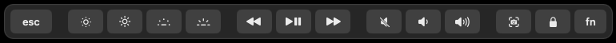
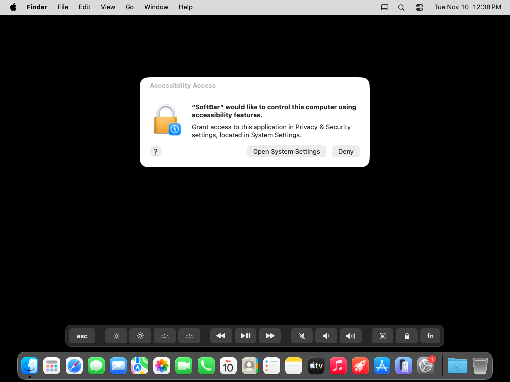
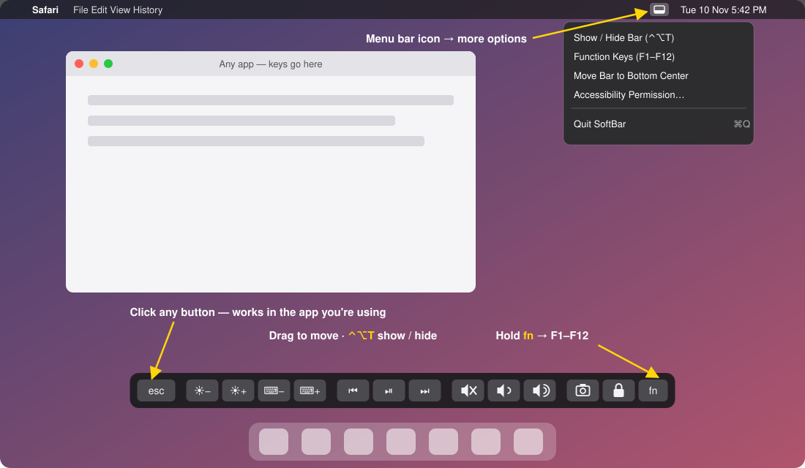

# SoftBar

An on-screen replacement for a broken MacBook Pro Touch Bar.
A small floating bar with **Esc, F1–F12, brightness, keyboard light, media, volume, screenshot and lock**.



Hold `fn` (or click **fn**) to switch the bar to **Esc + F1–F12**.

Works on Intel and Apple Silicon Macs running macOS 10.15 Catalina or newer. No admin password needed.

## Install

Open **Terminal** and paste:

```bash
curl -fsSL https://raw.githubusercontent.com/ahmadwaqar17/softbar/main/install.sh | bash
```

Or, if you were sent the file: `bash ~/Downloads/install.sh`

When it finishes, the **Accessibility** settings page opens by itself. Turn on the switch next to **SoftBar** and the bar starts working right away. macOS requires this one click for any app that presses keys, and no app is allowed to do it for you.



<sub>Real screenshot from a Mac right after running the install command. Click **Open System Settings** and turn on SoftBar.</sub>

If Apple's Command Line Tools aren't installed yet, a window pops up first. Click **Install** and the script continues by itself.

## Use



<sub>Illustration of SoftBar in use.</sub>

- Click the buttons. Volume, brightness and keyboard light repeat while held.
- Hold the **fn** key to show F1–F12, or click **fn** on the bar.
- **Ctrl+Option+T** shows or hides the bar. Drag it anywhere.
- The menu bar icon has more options and Quit.
- It starts automatically at login.

## Uninstall

```bash
curl -fsSL https://raw.githubusercontent.com/ahmadwaqar17/softbar/main/install.sh | bash -s -- --uninstall
```
